# Roo, the Switcheroo mascot



Roo is a blue kangaroo with the Switcheroo logo on his belly. He holds a small French flag with the logo on its white stripe and gives a thumbs up with his other paw. He lives on [zurmely.net/switcheroo](https://zurmely.net/switcheroo/), standing where the white and blue halves of the page meet.

## Files

| File | What it is |
| --- | --- |
| `roo.svg` | The rigged mascot with no animation. Every moving part is a named group with its pivot already set. |
| `roo-animated.svg` | The same drawing with an idle loop and a fluttering flag built in. Works as a plain ``, and also carries the action animations when pasted inline. |
| `roo.png` | 860 by 800 render with a transparent background, for places that need a bitmap. |
| `preview.html` | Open it in a browser to try the animations: Switch, Hop, Thumbs up and Flick the flag. |

Both SVGs are 430 by 400 and keep all their styles scoped to `#switcheroo`, so either one can be pasted straight into a page.

## Colors

| Use | Color |
| --- | --- |
| Body | `#0055A4` |
| Shading, far limbs, tail | `#003D78` |
| Belly and muzzle | `#E3EEF9` |
| Pouch | `#C9DCF1` |
| Inner ears, flag red | `#EF4135` |

The blue and red are the logo's own colors.

## Parts and pivots

| Id | What it is |
| --- | --- |
| `#roo` | The whole character. Origin at the feet, for hops and squash and stretch. |
| `#shadow` | Ground shadow. Shrink it while `#roo` is in the air. |
| `#head` | Origin at the neck. Holds the ears, eyes, lids, pupils and mouth. |
| `#ear-front`, `#ear-back` | Origin at each ear base. |
| `#lid-front`, `#lid-back` | Eyelids. `scaleY(0)` is open, `scaleY(1)` is closed. |
| `#pupils` | Translate a few pixels to look around. |
| `#arm-thumb` | Arm resting on the tummy with a thumbs up, with a soft drop shadow. Origin at the shoulder. |
| `#paw-thumb`, `#thumb` | Origin at the wrist. Rock it for a thumbs up pump. |
| `#flag`, `#arm-flag` | The hand flag and the paw holding it share one pivot. Give both the same rotation and the paw stays on the stick. |
| `#flag-wave` | Inside `#flag`, origin at the grip. Rotate it to flick the flag. |
| `#flag-cloth` | Ten slices (`.roo-fs0` to `.roo-fs9`) that make the cloth flutter. |
| `#belly-logo` | The Switcheroo logo, traced from `logo.png`. |
| `#wifi` | The signal. `scaleX(-1)` swaps the red pixel half (`#wifi-pixel`) and the blue half (`#wifi-smooth`). The arcs are `#wifi-arc-1` to `#wifi-arc-3` plus `#wifi-dot`. |
| `#logo-arrow` | The little switch arrow under the signal. |
| `#torso`, `#pouch` | Body and pouch. Origin at the hips, for breathing. |
| `#tail` | Origin at the tail base. Positive rotation lifts the tip. |
| `#leg-front`, `#foot-back` | Near leg and far foot. |

## Animation classes

Put these classes on the `<svg id="switcheroo">` element of `roo-animated.svg`:

| Class | Effect |
| --- | --- |
| `roo-idle` | Breathing, blinking, ear twitch, tail sway, looking around. On by default. |
| `roo-flag` | The flag flutters. On by default. |
| `roo-hop` | One hop with squash and stretch. Remove it on `animationend`. |
| `roo-swapped` | Flips the signal on his belly so the two halves trade places. |
| `roo-thumb` | Thumbs up pump with a nod. |
| `roo-flick` | Flicks the flag from his paw. |

Everything stops for visitors who ask for reduced motion.

The switch used on the site is a hop with the signal flipping halfway through:

```js
const roo = document.getElementById('switcheroo');
function doSwitch() {
  roo.classList.remove('roo-hop'); void roo.getBBox();
  roo.classList.add('roo-hop');
  setTimeout(() => roo.classList.toggle('roo-swapped'), 400);
}
roo.addEventListener('animationend', e => {
  if (e.animationName === 'roo-hop') roo.classList.remove('roo-hop');
});
```
